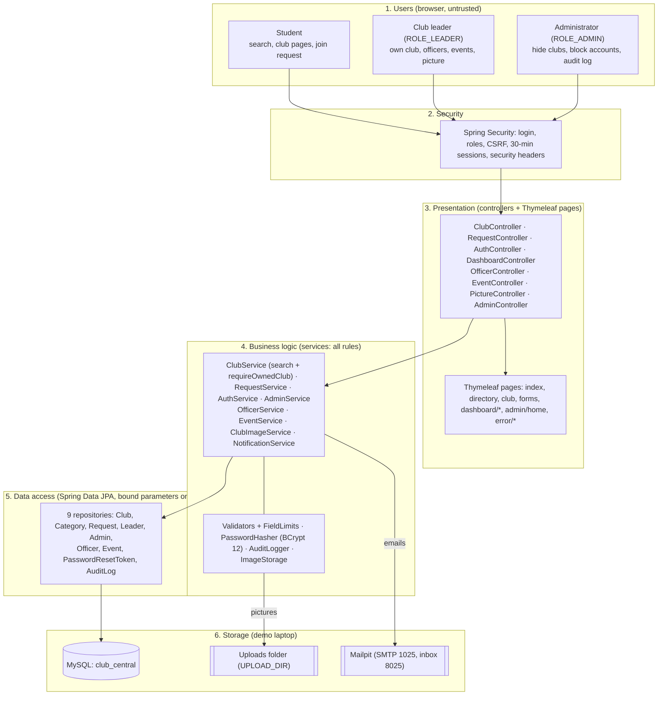

# Spartan Club Central: Architecture (as built)

This describes the system as it exists in the code, so a new teammate can find their way around in an afternoon (NFR-07).

## 1. In plain English

1. Spartan Club Central is one Java program (a Spring Boot application) with one MySQL database. People use it in an ordinary web browser.
2. **Students** search and filter clubs, read club pages, and send a join request without an account.
3. **Club leaders** register, log in, and manage their own club: create, edit, hide/show, delete, and read the requests sent to it.
4. **The administrator** can see every club and leader account, hide any club, block a fake leader account, send a password-reset link, and read the security log.
5. Every request goes through four layers in order: **pages → controllers → services → repositories → database**. All the rules (validation, "does this leader own this club?", password hashing) live in the services, in one place, so no page can skip them.
6. Passwords are stored only as BCrypt hashes. Students' names and emails are shown only to the leader of the club they contacted.
7. Emails (join requests, reset links) go to Mailpit on the demo laptop, so nothing real is ever sent.

## 2. Layers

Type: a **layered (n-tier) architecture using the MVC pattern**, in one Spring Boot program with one MySQL database (client–server). Each layer only calls the layer below it.

## 3. Where everything is

`src/main/java/com/spartanclubcentral/Spartan/Club/`

| Package | Classes | Job |
|---|---|---|
| `config` | `SecurityConfig`, `RoleBasedSuccessHandler`, `AdminSeeder`, `DemoLeaderSeeder` | Who may open what; where to go after login; create the admin from `ADMIN_EMAIL`/`ADMIN_PASSWORD`; demo-mode leader account |
| `security` | `AccountPrincipal`, `SecurityEventListener` | The logged-in account; login/logout events to the audit log |
| `controller` | `ClubController`, `RequestController`, `AuthController`, `DashboardController`, `OfficerController`, `EventController`, `PictureController`, `AdminController`, `CurrentUserAdvice`, `GlobalExceptionHandler` | Map web addresses to services and pages. No rules, no repositories |
| `service` | `ClubService`, `RequestService`, `AuthService`, `AdminService`, `OfficerService`, `EventService`, `ClubImageService`, `ClubPictures`, `ImageStorage`, `NotificationService`, `AuditLogger`, `PasswordHasher`, validators, `FieldLimits`, `EmailRules` | All business rules |
| `service.exception` | `NotFoundException`, `ValidationException` | Turned into the 404 page or into field messages |
| `repository` | 9 Spring Data interfaces | The only code that talks to MySQL |
| `model` | `Club`, `Category`, `ClubLeader`, `ClubOfficer`, `ClubEvent`, `Administrator`, `JoinRequest`, `RequestStatus`, `PasswordResetToken`, `AuditLog` | Tables as Java classes, every column mapped by name |
| `dto` | `JoinRequestForm`, `RegistrationForm`, `ClubForm`, `OfficerForm`, `EventForm`, `ResetPasswordForm` | What users typed into forms |

Uploaded pictures live in `UPLOAD_DIR` (default `./uploads`, not in Git); category pictures are original SVGs in `static/images/categories/`. Other files: `src/main/resources/templates/` (pages), `static/css/main.css` (one stylesheet), `database/` (schema, sample data, reset script), `scripts/LoadCheck.java` (performance check), `docs/` (this file, run guide, traceability, offline preview).

## 4. Routes

| Who | Address | Purpose |
|---|---|---|
| Everyone | `GET /`, `/clubs`, `/clubs/{id}` | Homepage, directory search, club profile |
| Everyone | `POST /clubs/{id}/requests`, `GET /clubs/{id}/requests/sent` | Join request and confirmation |
| Everyone | `/login`, `/register`, `/forgot-password`, `/reset-password` | Accounts |
| Leaders | `/dashboard/clubs/{id}/officers` (+ `/{oid}/edit`, `/move-up`, `/move-down`, `/remove`) | Officers shown on the club page (FR-13) |
| Leaders | `/dashboard/clubs/{id}/events` (+ `/new`, `/{eid}/edit`, `/{eid}/delete`) | Club events (FR-14) |
| Everyone | `GET /clubs/{id}/image` | Club picture, visible clubs only (FR-15) |
| Leaders | `/dashboard/clubs/{id}/picture` (+ `/remove`) | Upload/replace/remove the club picture (FR-15) |
| Leaders | `/dashboard`, `/dashboard/clubs/new`, `/dashboard/clubs/{id}/edit` · `/deactivate` · `/activate` · `/delete` · `/requests` | Club management and inbox, own club only |
| Admin | `/admin`, `/admin/clubs/{id}/deactivate` · `/activate`, `/admin/leaders/{id}/send-reset` · `/disable` · `/enable` | Administration |

Every change is a POST with a CSRF token. All other GET pages are public, so a mistyped address shows "Page not found"; any other method that isn't listed is blocked.

## 5. Three important flows

**Join request (FR-03, FR-07).** `RequestValidator` checks the fields. The request is **saved first** as SUBMITTED, then emailed to the club with the student as Reply-To, then marked DELIVERED or FAILED. An email problem can never lose the request or crash the page. A redirect to the confirmation page means refreshing doesn't resend.

**Ownership (SPR-03, SPR-04).** Every leader action calls `ClubService.requireOwnedClub(leaderId, clubId)` first. The leader id comes from the login session, never from the page. Another leader's club gives the 403 page and an `OWNERSHIP_DENIED` audit entry.

**Password reset (FR-11).** A 32-byte random token is emailed as a link. Only its SHA-256 hash is stored. It expires after 30 minutes, works once, and a new request cancels older links. The page answers the same way for every email address.

## 6. Security design

| Protection | How |
|---|---|
| Passwords (NFR-01, SPR-02) | BCrypt cost 12, 60-character hashes, never re-rendered or logged; 8 to 72 characters |
| Login required (SPR-01) | `SecurityConfig` roles; logged-out visitors go to `/login` |
| Own club only (SPR-03/04) | `ClubService.requireOwnedClub` before every club action and the inbox |
| Input (SPR-05) | Server-side validators with `FieldLimits` (the same numbers as the database); only Spring Data queries with bound parameters; Thymeleaf `th:text` escaping; links must be http(s) |
| Errors (SPR-06) | Generic 403/404/error pages; no stack traces; the same login error and the same "forgot password" answer for every email |
| Sessions (SPR-07) | 30-minute timeout, new session ID at login, HttpOnly cookie, POST-only logout |
| Audit (SPR-08) | `audit_log`: account ids and actions only; the table has no columns for emails, passwords or messages |
| Browser hardening | Content-Security-Policy `default-src 'self'` with no inline scripts or styles anywhere, `X-Frame-Options: DENY`, `nosniff`, `Referrer-Policy` |
| Secrets | Only in environment variables; the database user can't change tables; the demo password works only in demo mode |

## 7. Decisions on the requirement conflicts

| # | Decision |
|---|---|
| C1 | NFR-05 (99% uptime) deferred: it can't be measured on a demo laptop |
| C2 | HTTPS boundary is designed in; demos run on `http://localhost` |
| C3 | Added a required `contact_email`; `contact_info` stays optional text |
| C4 | `club_leader.club_id` can be empty until the leader creates a club; one club per leader |
| C5 | Hide (reversible) is the normal action; delete needs a confirmation page that warns the requests go too |
| C6 | Leaders use `/dashboard`, the administrator uses `/admin` |
| C7 | Anyone can register as a leader; the administrator can block a fake account and hide its club |
| C8 | DELIVERED means the mail server accepted the email; the leader's inbox is the backup |
| C9 | `PasswordHasher` and `AuthService` wrap Spring Security's own BCrypt and login handling |
| C10 | Added the `password_reset_token` table for FR-11 |

## 8. Changing something (NFR-07)

- **New field on clubs:** add the column to `database/schema.sql` and to `Club`, a limit to `FieldLimits`, a rule to `ClubValidator`, a field to `ClubForm`, and an input to `dashboard/club-form.html`. Hibernate runs with `ddl-auto=validate`, so a mismatch stops startup with a clear message.
- **New category:** `INSERT INTO category (category_name) VALUES ('Arts');`. It appears on the homepage and in every dropdown automatically.
- **New page that changes data:** a POST route in a controller, and a rule in `SecurityConfig` if it's outside `/dashboard` or `/admin`.
- Run `./mvnw test` before every pull request.
