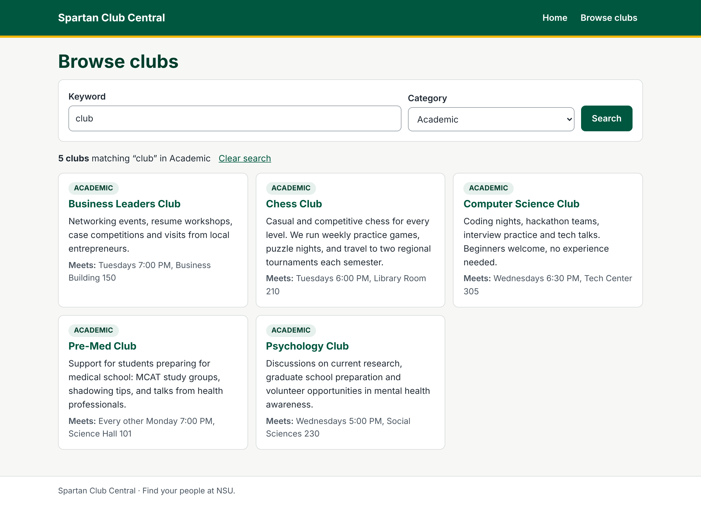
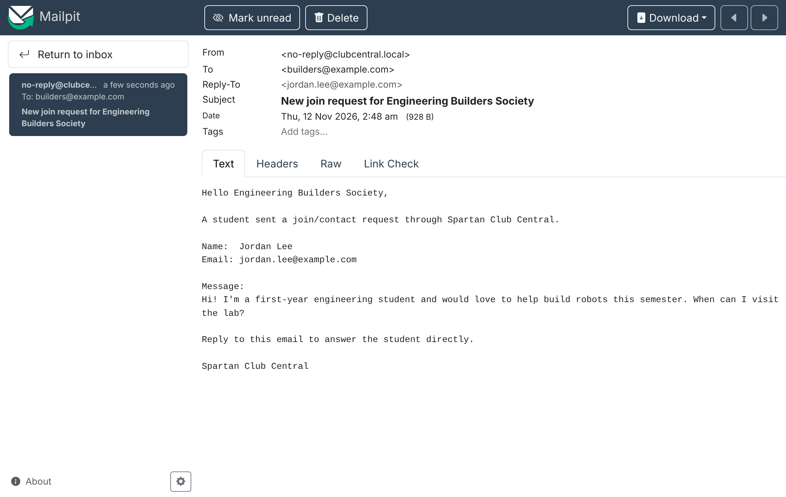

# Running Spartan Club Central Locally (Demo Setup)

> Prefer a web page? Open [`docs/local-run.html`](local-run.html) in any browser. It has these steps with Windows/Mac tabs and copy buttons, plus a clickable offline preview of the student pages (homepage, directory, club profiles, join form, pretend Mailpit inbox, leader registration and login, and the leader dashboard) that needs no Java, MySQL or Mailpit.

The whole system runs on one laptop. Nothing is hosted online and no real emails are sent.

| Piece | Tool (all free) | Address |
|---|---|---|
| Web app | Spring Boot (`./mvnw spring-boot:run`) | http://localhost:8080 |
| Database | MySQL 8 Community Server | localhost:3306, database `club_central` |
| Email | Mailpit (fake mail server with a web inbox) | SMTP localhost:1025, inbox http://localhost:8025 |

> **Phase 7 status (final):** every feature is built, hardened and documented:
> - `/` homepage: search box plus one card per category (one click to filtered results, NFR-03)
> - `/clubs` directory: keyword + category search (FR-01, FR-02)
> - `/clubs/{id}` club profile: description, meeting time, contact, social links (FR-05, FR-06)
> - Join/contact form on each club page: validated, saved, then emailed to the club through Mailpit (FR-03, FR-07)
>
> - Leader registration and login (`/register`, `/login`), a leader dashboard (`/dashboard`) and an administrator page (`/admin`), each open only to the right role (FR-04, SPR-01)
>
> - Leader dashboard: create your club, edit it, hide/show it, delete it (after a confirmation page), and read the join requests sent to it, only ever for your own club (FR-08, FR-09, FR-12, NFR-02, SPR-03, SPR-04)
>
> - Forgot/reset password by emailed one-time link (FR-11) and the administrator page: all clubs and leaders, hide/show any club, block a leader account, send a reset link, recent security log (FR-12)
>
> - Security headers (Content-Security-Policy, no framing), a performance check (`scripts/LoadCheck.java`), [docs/architecture.md](architecture.md), [docs/traceability.md](traceability.md), and the demo script at the end of this file
>
> 

---

## 1. Install the tools (once per laptop)

1. **Java 17 or newer**: Eclipse Temurin JDK (adoptium.net). Check with `java -version`.
2. **MySQL 8 Community Server**: dev.mysql.com/downloads. Remember the **root** password you choose. MySQL Workbench is optional but useful for looking at tables.
3. **Mailpit**: download from its GitHub releases page (github.com/axllent/mailpit), or on Mac run `brew install mailpit`. Needed from Phase 3 on.
4. **Git**, plus IntelliJ IDEA Community or VS Code.

You do **not** need to install Maven: the project includes the Maven wrapper (`mvnw` / `mvnw.cmd`).

## 2. Create the database (once)

From the project folder, run the schema as **root**:

```bash
mysql -u root -p < database/schema.sql
```

Then open a MySQL prompt (`mysql -u root -p`) and create the app's own user. It can read and write data but cannot drop or change tables (least privilege). Pick your own password and keep it out of Git:

```sql
CREATE USER 'club_app'@'localhost' IDENTIFIED BY 'pick-a-local-password';
GRANT SELECT, INSERT, UPDATE, DELETE ON club_central.* TO 'club_app'@'localhost';
```

Load the 32 sample clubs:

```bash
mysql -u root -p club_central < database/sample-data.sql
```

**Windows:** if `mysql` isn't recognized, use the full path, e.g. `"C:\Program Files\MySQL\MySQL Server 8.4\bin\mysql.exe"`, or run the same scripts from MySQL Workbench (*File → Open SQL Script*, then the lightning bolt).

## 3. Set environment variables (secrets never go in Git)

`application.properties` only contains placeholders. The real values come from your environment.

| Variable | Required? | Example | Default if not set |
|---|---|---|---|
| `DB_PASSWORD` | **Yes** | your `club_app` password | none (startup fails) |
| `DB_USER` | no | `club_app` | `club_app` |
| `DB_URL` | no | `jdbc:mysql://localhost:3306/club_central` | same |
| `ADMIN_EMAIL` / `ADMIN_PASSWORD` | from Phase 4 | `admin@clubcentral.local` / 8 to 72 characters | no admin account (created only once, the first time the app starts with both set) |
| `APP_BASE_URL` | no | `http://192.168.1.20:8080` for phone demos | `http://localhost:8080` |
| `MAIL_HOST` / `MAIL_PORT` | no | | `localhost` / `1025` (Mailpit) |

**IntelliJ (easiest):** *Run → Edit Configurations → SpartanClubApplication → Environment variables* → add `DB_PASSWORD=...`.

**Mac / Linux terminal** (lasts until you close the terminal):

```bash
export DB_PASSWORD="pick-a-local-password"
```

**Windows PowerShell** (lasts until you close the window):

```powershell
$env:DB_PASSWORD="pick-a-local-password"
```

## 3b. Upgrading a database from before Phase 8

If you created `club_central` before Phase 8 (or during it), run the upgrade script. It's safe to run again after each Phase 8 update; anything already there is skipped (your clubs, accounts and requests are kept). As root:

```bash
mysql -u root -p club_central < database/migrations/002-leaders-events-pictures.sql
```

In Workbench: *File → Open SQL Script* → `database/migrations/002-leaders-events-pictures.sql` → lightning bolt. Starting fresh instead? `schema.sql` already includes everything. If the app stops with `Schema-validation: missing table`, this step was skipped.

## 4. Run it

```bash
./mvnw spring-boot:run
```

On Windows: `mvnw.cmd spring-boot:run`. Wait for `Started SpartanClubApplication`, then open http://localhost:8080 (the homepage). Stop the app with **Ctrl+C**. From Phase 3 on, also start Mailpit first (run `mailpit` in another terminal).

### Demo mode: a ready-made club leader account

For class demonstrations, start the app with the `demo` profile and it creates this account the first time:

| Email | Password | Leads |
|---|---|---|
| `demo.leader@clubcentral.local` | `spartan-demo-2026` | Chess Club |

Mac / Linux:

```bash
SPRING_PROFILES_ACTIVE=demo DB_PASSWORD="pick-a-local-password" ADMIN_EMAIL="admin@clubcentral.local" ADMIN_PASSWORD="pick-an-admin-password" ./mvnw spring-boot:run
```

Windows PowerShell: run `$env:SPRING_PROFILES_ACTIVE="demo"` along with the other `$env:` lines, then `.\mvnw.cmd spring-boot:run`. In IntelliJ, add `SPRING_PROFILES_ACTIVE=demo` to the run configuration's environment variables.

The app's window confirms it with `Demo mode: created demo leader ...`. Demo mode also adds three made-up join requests to Chess Club so the request inbox has something to show. The password is still stored only as a BCrypt hash.

> **Laptop demos only.** This password is public in the code, so never use the `demo` profile on a real deployment. Without it, no demo account is created. An account created earlier stays in your database until you run `reset-demo.sql`.

## 5. Run the tests

Normal tests use an in-memory database, so they need no MySQL:

```bash
./mvnw test
```

Optional: check that **your** MySQL schema matches the code and that the sample data supports the demo searches. This only reads data:

```bash
RUN_MYSQL_TESTS=true DB_PASSWORD="pick-a-local-password" ./mvnw test -Dtest=MySqlSampleDataTest
```

PowerShell: set `$env:RUN_MYSQL_TESTS="true"` and `$env:DB_PASSWORD="..."`, then `mvnw.cmd test -Dtest=MySqlSampleDataTest`.

## 6. Reset before every demo

This removes all leader accounts, requests and log entries, then reloads the sample clubs, so every demo starts the same:

```bash
mysql -u root -p club_central < database/reset-demo.sql
```

```bash
mysql -u root -p club_central < database/sample-data.sql
```

## 7. Troubleshooting

| Problem | Fix |
|---|---|
| `Access denied for user 'club_app' (using password: NO)` | `DB_PASSWORD` isn't set in the window or run configuration that started the app. |
| `Access denied ... (using password: YES)` | Wrong password, or the user was created for a different host. Re-run the `CREATE USER` / `GRANT` step. |
| `Communications link failure` | MySQL isn't running. Start the MySQL service (Windows *Services*, Mac System Settings → MySQL, or `brew services start mysql`). |
| `Schema-validation: missing column [...]` or `missing table` | Your database is from an older schema. Drop it (`DROP DATABASE club_central;`) and redo step 2. |
| `Unknown database 'club_central'` | Step 2 wasn't run. |
| Admin login says "Invalid email or password" | `ADMIN_EMAIL`/`ADMIN_PASSWORD` weren't set when the app started, or the password was under 8 characters (the app's window says why). Set them and restart; the admin is only created if none exists. |
| `Port 8080 was already in use` | Another copy of the app is running. Stop it, or run with `--server.port=8081`. |
| `./mvnw: Permission denied` (Mac/Linux) | `chmod +x mvnw` |
| Emails don't appear (Phase 3+) | Start Mailpit and open http://localhost:8025. |

## What to check in the browser (Phase 2)

| Do this | You should see | Proves |
|---|---|---|
| Open http://localhost:8080 | 4 category cards: Academic 8, Cultural 8, Service 7, Sports 8 | NFR-03 |
| Click **Sports** | 8 Sports clubs, one click from the homepage | FR-02, NFR-03 |
| Search **robotics** | Only Engineering Builders Society (the word is only in its description) | FR-01, TC-02 |
| Keyword **club** + category **Academic** | 5 Academic clubs, keyword and category still filled in | TC-05 |
| Search **zzzzqq** | "No clubs found" message | TC-03 |
| Open any club | Meeting time, contact email, contact info and social links filled in | FR-05, FR-06, TC-06 |
| Go to http://localhost:8080/clubs/17 | "Page not found" (club 17 is inactive) | FR-12, SPR-06 |
| Shrink the window to phone width | Everything fits, no sideways scrolling | NFR-08 |

**Phase 3: join requests** (start Mailpit first, see below)

| Do this | You should see | Proves |
|---|---|---|
| On any club page, send the form with email `student@` and an empty message | Two red messages next to the fields and in a summary; your name is kept; nothing is sent | SPR-05, TC-21 |
| Fix the fields and press **Send request** | "Your request was sent" | FR-03, TC-07 |
| Open http://localhost:8025 | The email, sent to the club's contact address, Reply-To the student | FR-07, TC-09 |
| Refresh the confirmation page | No second email in Mailpit | No duplicates |
| Stop Mailpit (Ctrl+C) and send another request | Still "Your request was sent"; in Workbench `SELECT * FROM join_request;` shows it as `FAILED` | TC-10 |

**Phase 4: leader accounts** (start the app with `ADMIN_EMAIL` and `ADMIN_PASSWORD` set, see section 3)

| Do this | You should see | Proves |
|---|---|---|
| Logged out, open http://localhost:8080/dashboard | Sent to the login page | SPR-01, TC-17 |
| **Leader login → Create a leader account**, password `short` | "Password must be at least 8 characters."; the password boxes are emptied | SPR-05 |
| Register properly | "Your account was created. Log in to continue." | FR-04, TC-08 |
| Log in with a wrong password | "Invalid email or password." (the same message for unknown emails) | SPR-06 |
| Log in correctly | Your dashboard; header shows **Dashboard** and **Log out** | FR-04 |
| As a leader, open http://localhost:8080/admin | "That request wasn't allowed" | Roles |
| Workbench: `SELECT email, password_hash FROM club_leader;` | Only 60-character hashes starting `$2a$12$` | NFR-01, SPR-02, TC-18 |
| Workbench: `SELECT * FROM audit_log;` | ADMIN_SEEDED, REGISTERED, LOGIN_SUCCESS, LOGIN_FAILED, LOGOUT with account ids, no emails | SPR-08, TC-24 |
| **Log out**, then log in with your `ADMIN_EMAIL` | The Administrator page | FR-04 (admin) |

Your browser gets a new session cookie when you log in, and you're logged out after 30 minutes without activity (SPR-07).

**Phase 5: leader dashboard** (start in demo mode so the demo leader exists, see "Demo mode" above)

| Do this | You should see | Proves |
|---|---|---|
| Log in as `demo.leader@clubcentral.local` / `spartan-demo-2026` | Dashboard with Chess Club, "Visible to students", **Join requests 3** | FR-04 |
| Click **Join requests** | Three requests (one marked "Email not sent"), only Chess Club's | NFR-02, SPR-04 |
| **Edit club**, website `javascript:alert(1)` | "Enter a full web address starting with https://"; your other changes are kept | SPR-05 |
| Fix it, change the meeting time, **Save changes** | "Your changes were saved."; the public Chess Club page shows the new time | FR-09, TC-12 |
| **Hide club from students**, then open http://localhost:8080/clubs/1 | "Page not found"; Chess Club is gone from search. **Show club** brings it back | FR-12, TC-13 |
| Register and log in as a second leader, then open http://localhost:8080/dashboard/clubs/1/requests | "That request wasn't allowed", with no student data | SPR-03, TC-19, TC-20 |
| As that leader, **Create your club** | "Your club was created..."; students can find it right away | FR-08, TC-11 |
| **Delete this club permanently...** → **Yes, delete permanently** | The warning lists how many requests will go; afterwards the club is gone and you can create a new one | FR-12, TC-14 |
| Workbench: `SELECT action, actor_id, target_id FROM audit_log;` | CLUB_EDITED, CLUB_DEACTIVATED, CLUB_ACTIVATED, OWNERSHIP_DENIED, CLUB_CREATED, CLUB_DELETED | SPR-08 |

**Phase 6: password reset and administrator** (Mailpit running)

| Do this | You should see | Proves |
|---|---|---|
| **Leader login → Forgot your password?**, enter the demo leader's email | "If that email belongs to a club leader account, we've sent a link..." | FR-11 |
| Do the same with `nobody@example.com` | The exact same message, and no email in Mailpit | SPR-06 (no account discovery) |
| Open the email in Mailpit (http://localhost:8025) and click the link | "Choose a new password" | FR-11, TC-15 |
| Try `short`, then a proper new password | Error, then "Your password was changed."; the old password no longer works | FR-11, TC-15 |
| Open the same link again | "This link doesn't work" (links work once, for 30 minutes) | TC-16 |
| Log in with your `ADMIN_EMAIL` | Clubs (with leader and request counts), Leader accounts, Security log; no student names or emails | FR-04, NFR-02 |
| **Hide** Chess Club, then open http://localhost:8080/clubs/1 | "Page not found"; **Show** brings it back | FR-12 |
| **Block** the demo leader, then try to log in as them | "Invalid email or password."; **Unblock** restores access | Conflict C7 |
| **Send reset link** | "A password reset link was emailed to the leader."; the email is in Mailpit | FR-11 |
| Scroll to **Security log** | PASSWORD_RESET_REQUESTED/COMPLETED, RESET_LINK_SENT, LEADER_DISABLED, CLUB_DEACTIVATED... | SPR-08, TC-24 |

**Phase 8A: club officers** (demo mode)

| Do this | You should see | Proves |
|---|---|---|
| Open Chess Club's page | **Officers**: Demo Leader (President), Priya Patel (Treasurer), Marcus Green (Tournament Director) | FR-13 |
| As the demo leader: Dashboard → **Manage officers**, add a name without a role | "Enter their role, like President or Treasurer." | SPR-05 |
| Add it properly, then **Move up** | The public page shows the new officer in the new order | FR-13 |
| Open http://localhost:8080/dashboard/clubs/18/officers | "That request wasn't allowed" (Soccer Club isn't yours) | SPR-03 |

**Phase 8B: club events** (demo mode; load `sample-data.sql` the same day, since its events are dated from that day)

| Do this | You should see | Proves |
|---|---|---|
| Open the homepage | **Coming up this week**: the next events from all clubs | FR-14 |
| Open Chess Club | **Upcoming events**: Blitz tournament, Beginner lesson night, with dates like "Sun, Nov 15 · 6:00 PM to 8:00 PM" | FR-14 |
| As the demo leader: **Post an event** that ends before it starts | "The end time must be after the start time." | SPR-05 |
| Fix it and post | It appears on Chess Club's page in date order | FR-14 |
| Open http://localhost:8080/dashboard/clubs/18/events | "That request wasn't allowed" | SPR-03 |

Automated tests: `./mvnw test` should report 158 passing and 1 skipped.

## Performance check (NFR-04)

With the app running, in a second window:

```bash
java scripts/LoadCheck.java
```

It sends 500 searches from 100 users at the same moment and prints `PASS` if 95% finish in under 2 seconds. On a 4-core test machine: median 282 ms, 95th percentile 706 ms, slowest 1.2 s, no failures. Run it on the demo laptop and note your numbers for the report. It only reads data.

## Mailpit (fake email inbox, needed from Phase 3)

Mailpit catches every email the app sends and shows it in a web inbox. Nothing ever reaches a real mailbox.

- **Mac:** `brew install mailpit`, then run `mailpit` in its own Terminal window.
- **Windows:** download the `windows-amd64.zip` file from github.com/axllent/mailpit/releases, unzip it, and double-click `mailpit.exe` (or run `.\mailpit.exe` in PowerShell from that folder).

Leave it running, start the app in a second window, and open the inbox at http://localhost:8025. If Mailpit isn't running, the site still works: requests are saved with status `FAILED`, and leaders will still see them on their dashboard from Phase 5.



## Demo checklist

**The day before**
- [ ] `git pull` and `./mvnw test`: 134 passing, 1 skipped
- [ ] Practice the script below twice and time it (about 10 minutes)
- [ ] Record a backup screen video of the full script
- [ ] Copy `docs/local-run.html` to the desktop as a no-setup backup

**Right before (5 minutes)**
- [ ] Reset the data (section 6): `reset-demo.sql`, then `sample-data.sql`
- [ ] Start Mailpit, then the app **in demo mode** with `ADMIN_EMAIL`/`ADMIN_PASSWORD` set
- [ ] Open tabs: http://localhost:8080, http://localhost:8025 (Mailpit), MySQL Workbench
- [ ] Browser zoom 100%; close other tabs and notifications

**Logins**

| Account | Email | Password |
|---|---|---|
| Demo club leader (demo mode) | `demo.leader@clubcentral.local` | `spartan-demo-2026` |
| Administrator | your `ADMIN_EMAIL` | your `ADMIN_PASSWORD` |

## Demo script (about 10 minutes)

| # | Do | Say / show | Requirement |
|---|---|---|---|
| 1 | Homepage → click **Sports** | One click to filtered results; 8 Sports clubs | FR-02, NFR-03 |
| 2 | Search **robotics**, then keyword **club** + **Academic** | Found through the description; both filters apply together | FR-01, TC-02, TC-05 |
| 3 | Open **Chess Club** | Description, meeting time, contact, social links | FR-05, FR-06, TC-06 |
| 4 | Send the join form with email `student@` and no message | Clear messages next to each field; nothing saved | SPR-05 |
| 5 | Fix it and send | "Your request was sent"; the email arrives in Mailpit with Reply-To the student | FR-03, FR-07, TC-07, TC-09 |
| 6 | Open `localhost:8080/dashboard` while logged out | Sent to the login page | SPR-01, TC-17 |
| 7 | Log in as the demo leader → **Join requests** | The new request plus 3 samples; only Chess Club's; nobody else can see them | NFR-02, SPR-04 |
| 8 | **Edit club**: change the meeting time | The public page updates immediately | FR-09, TC-12 |
| 9 | **Hide club**, show `/clubs/1` in another tab, then **Show** | Hidden clubs disappear for students without losing data | FR-12, TC-13 |
| 10 | Register a second leader; open `/dashboard/clubs/1/requests` | "That request wasn't allowed": the ownership rule | SPR-03, TC-19 |
| 11 | Log out → **Forgot your password?** → link in Mailpit → new password → log in | One-time, 30-minute link; only a hash is stored | FR-11, TC-15 |
| 12 | Log in as admin: clubs, leaders, **Block** the second leader, **Security log** | Account recovery, deactivations, audit trail without personal data | FR-12, SPR-08 |
| 13 | Workbench: `SELECT email, password_hash FROM club_leader;` | Only `$2a$12$...` hashes | NFR-01, TC-18 |
| 14 | Shrink the browser to phone width | Everything fits | NFR-08 |

**If something breaks:** switch to `docs/local-run.html` (offline preview) or the backup video, and keep talking through the same steps.
